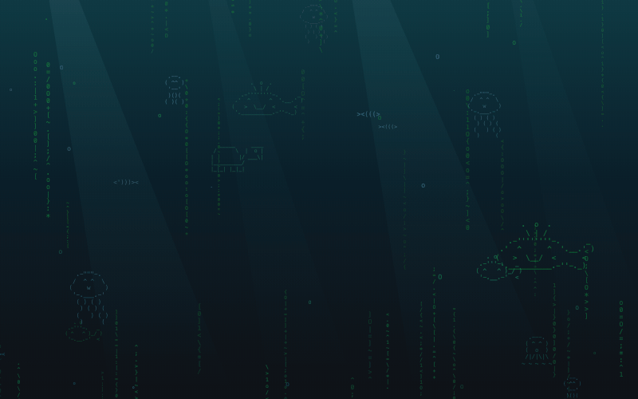
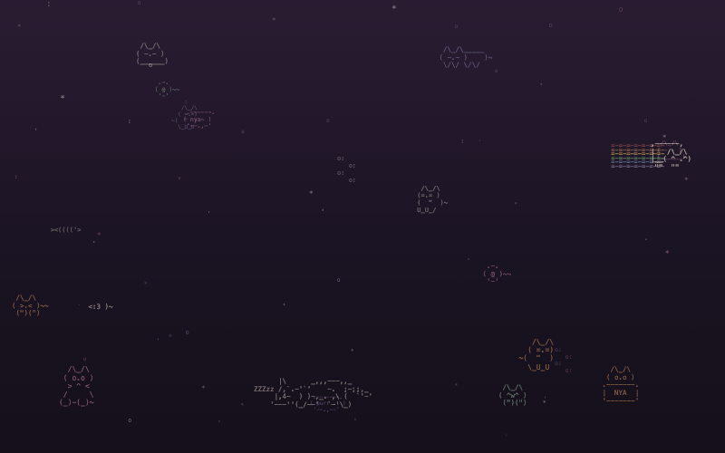
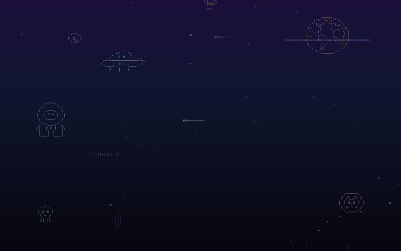
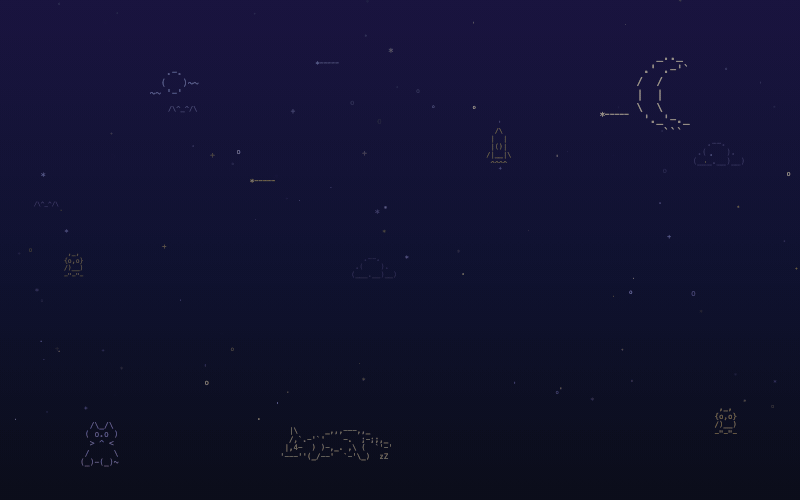

<div align="center">

# 🐾 hermes-ascii-backgrounds

**Cute, animated ASCII-art backgrounds for [Hermes Agent](https://github.com/NousResearch/hermes-agent) Desktop.**

Whales swim, cats chase mice, comets fly — all drawn with plain ASCII characters, right behind your chat.

アスキーアートだけで描いた、動く Hermes Desktop の背景コレクションです 🐋🐱🚀

`/\_/\`  &nbsp; `><(((>` &nbsp; `*=~~-----` &nbsp; `( o.o )`

</div>

---

## 🎨 Gallery

<table>
<tr>
<td width="50%" align="center">

### 🐋 aquarium


Whales, jellyfish, an octopus, a turtle and little fish in the deep sea, under matrix-green ASCII rain.

`python3 build.py aquarium`

</td>
<td width="50%" align="center">

### 🐱 nyan


Cats everywhere! A rainbow nyan cat, a cat chasing a mouse, a cat in a box, napping cats and "nya~" bubbles.

`python3 build.py nyan`

</td>
</tr>
<tr>
<td width="50%" align="center">

### 🚀 cosmos


Saturn, a drifting astronaut, a UFO, comets, rockets and a space cat in a helmet, flying through a nebula.

`python3 build.py cosmos`

</td>
<td width="50%" align="center">

### 🌙 starry-night


Twinkling stars, shooting stars, the moon, a rocket, a sleepy cat and an owl under the night sky.

`python3 build.py starry-night`

</td>
</tr>
</table>

<sub>GIFs are sped up a little. In the app everything drifts slowly and softly behind your messages.</sub>

---

## ✨ Install

You need Hermes Desktop and Python 3 (standard library only — nothing to `pip install`).

```sh
git clone https://github.com/UMEBOSHIISAN/hermes-ascii-backgrounds.git
cd hermes-ascii-backgrounds

python3 build.py                     # see all themes
python3 build.py nyan                # write ~/.hermes/skins/nyan.yaml
hermes config set display.skin nyan  # use it
```

Then **quit and relaunch Hermes Desktop** 🎉

- Want them all? `python3 build.py --all`, then switch with `hermes config set display.skin <name>`.
- Using a custom `HERMES_HOME`? The script writes there instead.

> **💡 Background looks tinted?** If your window translucency is on, your desktop wallpaper shows through and changes the colors. Set **Translucency to 0** in Hermes' Appearance settings.

### Go back to the default look

```sh
hermes config set display.skin default
```

---

## 🖌️ Make your own

Every theme is **one small Python file** in [`themes/`](themes/). Draw some ASCII art, say where it goes and how it moves:

```python
ART = {
    "cat":  [" /\\_/\\", "( o.o )", " > ^ <"],
    "fish": ["><(((>"],
}

# (art,  x,   y,   color,   opacity, size, motion,  seconds, delay)
SCENE = [
    ("cat",  200, 820, "#FF9EC4", 0.45, 16, "bob",    6,  0),   # floats in place
    ("fish",   0, 400, "#9EF0D0", 0.35, 15, "right", 40,  0),   # swims across
]
```

Motions: `left` / `right` (swim across) · `up` / `down` (drift) · `bob` (float in place) · `fly` (shooting-star streak).
Layers: twinkling stars, falling particles (snow, bubbles, petals…), matrix rain and light rays.

1. Copy [`themes/_template.py`](themes/_template.py) to `themes/<your-theme>.py`
2. `python3 build.py <your-theme>` and restart Hermes Desktop to see it
3. Happy? Make a GIF with `python3 tools/make_gif.py <your-theme>` (needs Chrome + ffmpeg)

**New themes are very welcome!** 🐧🦖🍰👻 See [CONTRIBUTING.md](CONTRIBUTING.md).

---

## 🔧 How it works

Hermes skins (`~/.hermes/skins/*.yaml`) can carry a `customCSS` field, which Hermes Desktop injects as a `<style>` tag.
`build.py` turns a theme into an **animated SVG** (SMIL) and sets it as the chat background — **no changes to Hermes itself**.

- Creatures are faint and sit *behind* the messages, so chat stays readable. Clicks pass straight through.
- The SVG is embedded as a URL-encoded `data:` URL. A backslash inside a CSS string is an escape character, so `\` in ASCII art is encoded as `%5C` — otherwise the image silently fails to load. A copy is also written next to the skin and referenced via `file://` as a fallback.
- Hermes caps `customCSS` at 32 KiB. `build.py` stops with a friendly message if a theme gets too big.

---

<div align="center">

Made with `( ^w^ )` and a lot of ASCII · [MIT License](LICENSE)

</div>
